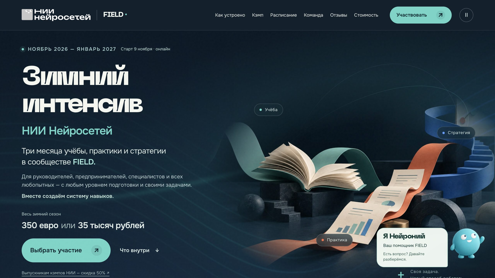

# FIELD · зимний интенсив НИИ Нейросетей

Полный проект лендинга, переданный команде 9 октября 2026 года. Рабочая версия — **v4.6**.

- **Посмотреть сайт:** https://nii-field-winter-v3.vercel.app/
- **Текущий код и контент:** [site/](site/)
- **Публикация GitHub → Тильда (основной путь):** [docs/GITHUB-TILDA.md](docs/GITHUB-TILDA.md)
- **Перенос в Тильду (старая схема):** [docs/TILDA.md](docs/TILDA.md)
- **Что и где редактировать:** [docs/EDITING.md](docs/EDITING.md)
- **Публикация на другом хостинге:** [docs/DEPLOYMENT.md](docs/DEPLOYMENT.md)
- **Проверки и ограничения:** [docs/QA.md](docs/QA.md)
- **Что вошло в передачу:** [docs/HANDOFF.md](docs/HANDOFF.md)



## Как забрать проект без терминала

Войдите в GitHub-аккаунт, который приглашён в этот приватный репозиторий. Нажмите **Code → Download ZIP**, распакуйте архив. Текущие страницы, изображения и шрифты находятся в `site/`, подготовленные файлы для Тильды — в `tilda/`.

Открытие HTML двойным щелчком недостаточно для полной проверки: браузер блокирует часть загрузок через file://. Для календаря и Нейрония используйте локальный сервер ниже.

## Как запустить на компьютере

Нужен Node.js; проект проверен на Node.js 24. Внешних npm-зависимостей нет, `npm install` не нужен.

Если у вас установлен Git:

```bash
git clone https://github.com/deygenson/NN6-landing.git
cd NN6-landing
npm start
```

Затем откройте **http://127.0.0.1:3000**. Для остановки нажмите **Ctrl+C** в том же терминале.

Если проект скачан ZIP-архивом в стандартную папку Downloads на Mac:

```bash
cd "$HOME/Downloads/NN6-landing-main"
npm start
```

Если порт занят:

```bash
cd "$HOME/Downloads/NN6-landing-main"
npm start -- --port 3001
```

Адрес станет http://127.0.0.1:3001. Если вы распаковали проект в другое место, откройте терминал из его папки.

## Проверить и собрать

После клонирования в текущую папку:

```bash
cd NN6-landing
npm test
npm run build
```

Если вы уже внутри папки проекта, повторный `cd` не нужен. Готовая статическая версия появится в `dist/`. Сборка проверяет ссылки, локальные ресурсы, синтаксис и ответы Нейрония, затем копирует текущий сайт.

`dist/` — результат сборки. Правки делайте в `site/`.

## Структура

| Папка | Что внутри |
|---|---|
| `site/` | Одна страница лендинга, CSS, JavaScript, фотографии, логотипы, иллюстрации, шрифты, база Нейрония |
| `api/` | Точка входа необязательного обработчика Нейрония для Vercel |
| `scripts/` | Переносимые запуск, сборка, проверки и экспорт для Тильды |
| `tests/` | 54 проверки Нейрония |
| `tilda/zero-block/` | HTML-файл со встроенным CSS для импорта дизайна |
| `tilda/t123/` | Фрагмент для вставки работающего сайта через iframe |
| `docs/` | Инструкции, карта редактирования, ограничения и источники |
| `history/project/` | Полная история исходной папки проекта: брифы, программа, аналитика, код версий, исходные иллюстрации, исследования, скриншоты и архивы |
| `history/deliverables/` | Ранее выпущенные архивы, отчёты и изображения |
| `history/handoffs/` | Журнал предыдущих этапов передачи |
| `dist/` | Создаётся сборкой; в Git не хранится |

## Что важно при продолжении работы

- Визуал и содержание текущего сайта не менялись при упаковке: `site/` соответствует переданной v4.6.
- `history/` — история решений. Там есть старые цены, формулировки и абсолютные пути прежнего рабочего компьютера. Не используйте старые скрипты как основной способ сборки и не возвращайте оттуда отменённые условия.
- Нейроний работает как справочник по базе сайта. Платная модель отключена; для обычной работы ключи не нужны.
- Платёжные кнопки ведут на существующие страницы НИИ, Robokassa и Allpay. Реальная оплата и письмо-приглашение не проверялись при передаче.
- GitHub-репозиторий приватный. Доступ к нему не даёт автоматически доступ к Тильде, Vercel, оплатам и почте.
- Репозиторий не подключён автоматически к существующему production-проекту. Обычный push сюда сам по себе не обновляет текущий публичный сайт.
- Индексация текущей версии отключена через noindex. Перед поисковым продвижением согласуйте основной домен.

## Как дать доступ коллегам

Владелец открывает **Settings → Collaborators → Add people**, выбирает GitHub-аккаунты коллег и отправляет приглашения. После принятия приглашения они смогут пользоваться этой ссылкой:

https://github.com/deygenson/NN6-landing

Перед публикацией изменений создавайте отдельную ветку и проверяйте сайт. Предыдущая v4.6 сохранена в истории и в готовых архивах.
