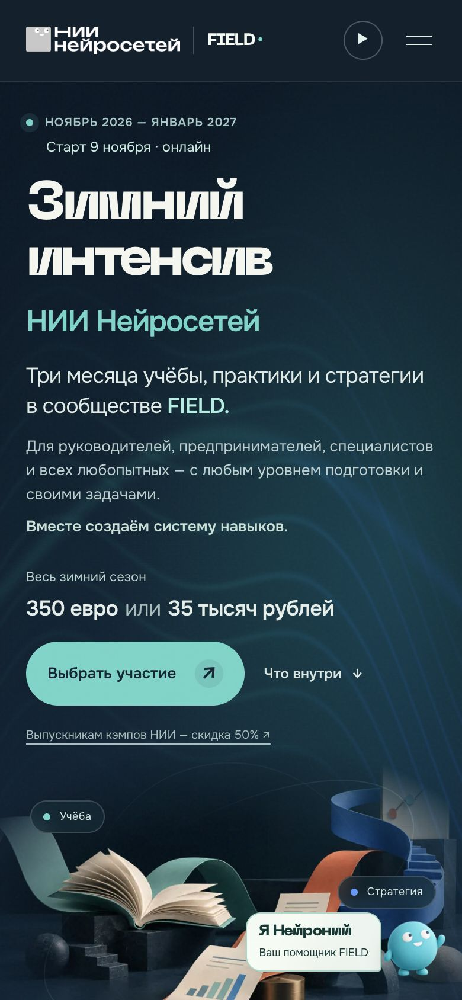
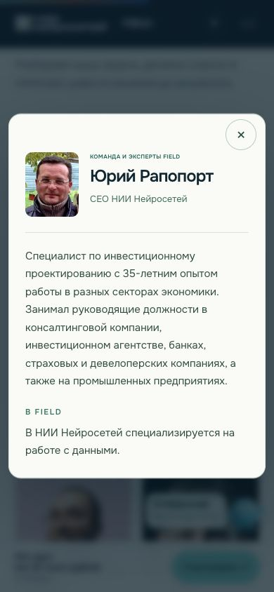
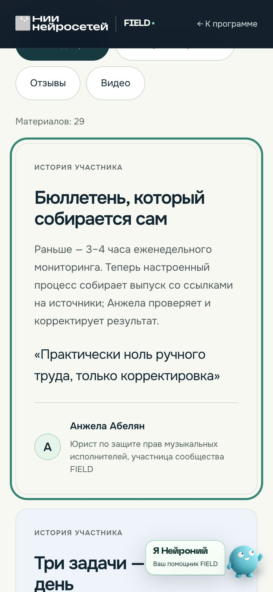
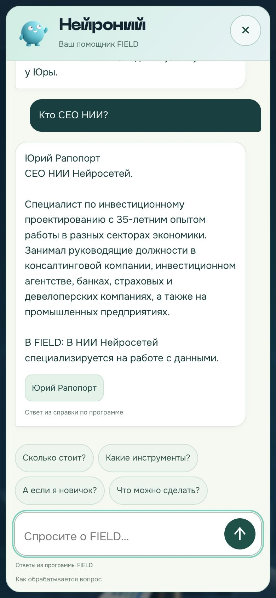

# FIELD v4.6 — аудит сайта и выполненные правки

Дата: 9 октября 2026. Проверены главная страница, страница выпускников, отдельная подборка отзывов, помощник, навигация и переходы к оформлению.

**Статус: опубликовано.** Публичная ссылка: [nii-field-winter-v3.vercel.app](https://nii-field-winter-v3.vercel.app/).

## Главный вывод

У сайта уже есть сильная основа: конкретные рабочие задачи, программа, реальные истории участников, фотографии команды и понятный состав участия. Основная проблема была в пути к решению: первый экран поздно показывал цену, длинная страница требовала лишней прокрутки, а некоторые переходы не сохраняли намерение посетителя. Например, карточка «Стратегия» открывала общий календарь.

В этой версии исправлены эти препятствия без нового визуального переосмысления. Рост продаж пока не измерен: для вывода о конверсии нужны данные реальных посетителей.

## Путь посетителя: восемь проверенных шагов

### 1. Понять предложение — улучшено

**Задача:** за первый экран понять, что это, кому подходит, когда начинается и сколько стоит.

Что изменено:
- Цена всего зимнего сезона поднята перед основной кнопкой.
- Добавлено «Старт 9 ноября · онлайн».
- Сохранены три месяца, FIELD и аудитория с любым уровнем подготовки.
- Уточнено расстояние между датами на мобильном: надписи больше не слипаются.
- Сохранены иллюстрация, фирменная типографика, тёмный фон и существующая анимация.

В проверке 390 × 844 цена и основная кнопка видны на первом экране. На настольном 1280 × 720 основная кнопка также попадает в первый экран. На компактном экране 320 × 740 часть содержания естественно требует прокрутки.

### 2. Найти своё направление — исправлено

**Задача:** выбрать кэмп, практику или стратегию без повторного поиска.

Карточки «Практика» и «Стратегия» теперь открывают календарь с соответствующим фильтром. В строке результата указан месяц, выбранное направление и число событий. Добавлены прямые пункты меню «Расписание» и «Команда», на мобильном также «Вопросы и ответы».

Сохранены 14 событий кэмпа, 15 событий практики и 4 события стратегии. Это 33 события за сезон. Отдельный календарь содержит 19 событий сверх основного кэмпа.

Проверены все девять сочетаний трёх месяцев и трёх фильтров: ноябрь 5 / 4 / 1, декабрь 7 / 6 / 1, январь 7 / 5 / 2 — всего / практика / стратегия. На публичной v4.6 отдельно подтверждён переход из карточки «Стратегия» к одному ноябрьскому событию.

### 3. Изучить расписание и практические задачи — работает

Сохранены ранее согласованные правки:
- 11 ноября: Валентин Васин и приглашённые эксперты;
- 12 и 19 ноября: согласованные описания Александра Ярыгина;
- 26 ноября и 15 декабря: задачи из «Стола заказов», без возвращения темы профориентации, отдельной ветки и ограничения «до 90 минут»;
- 9 декабря: «ИИ делает нас глупее?» с исправленным описанием;
- единая строка времени: 19:00 Москва, 18:00 Израиль, 17:00 CET;
- три парные серии, шесть связанных карточек;
- шесть маршрутов от рабочей задачи к применению ИИ;
- библиотека записей и курс «Творческая мастерская».

Улучшена читаемость примечания под кэмпом: раньше оно было слишком тёмным на тёмном фоне. Раскрытия тем, примеров и FAQ сохранены.

### 4. Познакомиться с командой — исправлено

Юрий Рапопорт в карточке, раскрытии, странице выпускников и базе Нейрония указан как **CEO НИИ Нейросетей**. Повтор описания его функции убран из биографии: функция остаётся в разделе «В FIELD».

Сохранены 10 экспертов, фотографии Юрия и Иоганны, раскрытие по имени и фотографии. Должность Иоганны — «коммьюнити-менеджер Field», в согласованном владельцем написании. Кнопки имени и закрытия раскрытия получили удобную область нажатия.

### 5. Увидеть доказательства результата — исправлено

На главной шесть историй теперь образуют ручную ленту: три карточки на компьютере, две на промежуточных размерах, одна с подсказкой продолжения на телефоне. Есть стрелки, счётчик, прокрутка и свайп. Автоматического перелистывания нет.

Отдельная страница сохраняет 29 материалов: 12 кейсов, 3 отзыва и 14 видео.

Исправлена воспроизведённая ошибка: при включённом фильтре «Видео» прямая ссылка на историю могла оставлять эту историю скрытой. Теперь переход к ней открывает нужный материал и сбрасывает несовместимый фильтр. После публикации сценарий повторён успешно.

### 6. Выбрать участие — улучшено

Основные кнопки в первом экране, шапке, закреплённой мобильной панели и финальном блоке ведут прямо к карточке участия. На телефоне список включённых возможностей размещён после карточки, чтобы не отодвигать оплату вниз.

Суммы сохранены:
- участие: 350 евро или 35 тысяч рублей;
- выпускники: 175 евро или 17,5 тысячи рублей;
- VIP: 1000 евро или 100 тысяч рублей.

Скидка написана без лишнего тире: «Выпускникам кэмпов НИИ: скидка 50%». Оплата относится ко всему сезону, а не только к кэмпу.

### 7. Оформить участие — переходы проверены, выдача доступа не проверена

В браузере открыты:
- оформление обычного участия в евро — 350 евро, один участник;
- оформление обычного участия в рублях — 35 000 рублей;
- Robokassa для выпускников — 17 500 рублей;
- Allpay для выпускников — 175 евро.

Поля не заполнялись, платёжные кнопки не нажимались. Поступление денег и отправка приглашения после оплаты не проверены.

Четыре ссылки на исходные документы открываются: [оферта](https://ne-institute.com/oferta), [политика обработки данных](https://ne-institute.com/privacy), [Terms and Conditions](https://ne-institute.com/termsandconditions), [Privacy Policy](https://ne-institute.com/privacyeng). Это проверка доступности ссылок, а не юридическая экспертиза документов.

**Обнаружено на исходном сайте НИИ:** под корзиной евро остаются старые описания программы, включая тему профориентации на 26 ноября. Сам товар в корзине называется «Кэмп НН6», хотя продаётся весь сезон. Эту часть стоит синхронизировать с FIELD в исходном редакторе сайта НИИ. Изменения текущего лендинга не меняют удалённую платёжную страницу.

### 8. Получить ответ Нейрония — улучшено

Исправлены ответы о CEO и распознавание варианта фамилии «Раппопорт». Исправлен повторный переход из ответа к карточке эксперта. На опубликованном сайте получен ответ с правильной должностью.

Проверено 54 вопроса, все проверки прошли. Помощник использует подготовленную справку и поиск по базе сайта. Это ограниченный справочный механизм, а не подключённая платная языковая модель. Вопросы за пределами базы направляются к Юрию.

На мобильном уменьшены персонаж и подпись. Дальнейшее уменьшение перекрытий стоит оценить на реальном устройстве: любой постоянно закреплённый помощник занимает часть экрана.

## Техническая проверка

- Три страницы: главная, выпускники, отзывы.
- 168 внутренних и внешних ссылок в HTML просмотрены структурно; внутренние пути и якоря проверены, неработающих внутренних целей нет. Это не означает, что каждый внешний сайт прошёл отдельный функциональный тест.
- Нет повторяющихся идентификаторов на страницах.
- Все используемые локальные изображения, шрифты и скрипты включены в архив.
- У изображений есть атрибут alt; у декоративных он может быть пустым.
- 19 логотипов компаний сохранены.
- Проверки ширин 320, 390, 768, 1280 и 1440 пикселей: горизонтального переполнения страницы не обнаружено.
- Проверены мобильное меню, переход к оплате, листание историй, закрытие карточки эксперта и ответ помощника.
- На проверенных публичных страницах ошибок JavaScript в журнале браузера не обнаружено.
- Синтаксис JavaScript и целостность ZIP проверены.
- Публикуемый набор: 59 файлов, около 1,70 МБ суммарно без сжатия, плюс конфигурация Vercel. Это размер всех трёх страниц и ресурсов, не вес первого экрана.
- Добавлены canonical, Open Graph и Twitter metadata. Реальный вид превью после обновления кэша Telegram отдельно не проверялся.
- Новые библиотеки, аналитические системы и платные API не добавлены.

Ориентиры проверки: [WCAG 2.2: размер цели](https://www.w3.org/WAI/WCAG22/Understanding/target-size-minimum.html), [Core Web Vitals](https://web.dev/articles/vitals), [Open Graph](https://ogp.me/). Полное соответствие WCAG и реальные показатели Core Web Vitals не заявляются.

## Что ещё улучшить по приоритету

1. **Синхронизировать покупку и обещание.** В исходном сайте НИИ привести название товара и оставшиеся тексты к продаже трёхмесячного участия. Это важнее дополнительной анимации.
2. **Проверить цепочку после платежа.** Владелец платёжной системы должен проверить успешную оплату, письмо, приглашение и доступ к архиву для обеих валют. До этого нельзя считать весь процесс автоматическим и проверенным.
3. **Выбрать основной адрес для продвижения.** У текущей Vercel-версии сохранён прежний noindex. Ссылкой можно делиться, но поисковое продвижение требует отдельного решения о домене и индексации.
4. **Измерять поведение, затем сокращать.** Страница по-прежнему содержательная и длинная. Теперь есть быстрые переходы. Следующий шаг — выяснить, где реальные люди останавливаются: перед выбором программы, отзывами или оплатой. Убирать разделы без данных преждевременно.
5. **Проверить на реальных телефонах.** Выполнена эмуляция размеров в браузере, но не проверка физического iPhone/Android, мобильного Safari и медленной сети. В первую очередь — фиксированный помощник, меню, высота открытой карточки и платёжная форма.

## Публикация и восстановление

- Production: https://nii-field-winter-v3.vercel.app/
- Vercel: READY, production.
- Deployment ID: dpl_6uUPKhBYfkYJSTdbXhF9rt9HfGJo.
- Уникальный адрес: https://nii-field-winter-v3-py9t0h257-dmitriis-projects-8673976b.vercel.app
- Предыдущая версия для отката: dpl_D26o1B8PGjusMccZdw5Y7fjYK8uz.
- Архив: FIELD-лендинг-v4.6.zip.
- Публичный доступ сохранён; настройки защиты preview не менялись.

## Изменённые файлы

Готовый сайт: index.html, alumni.html, reviews.html, style-v4-6.css, app-v4-6.js, reviews-v4-6.js, neuroniy-v4-6.js, neuroniy-engine-v4-6.js, neuroniy-knowledge-v4-6.json, api/neuroniy.js.

Воспроизводимая сборка: build_v4_6.py, v4-6-overrides.css, ux-v4-6.js, reviews-v4-6.js, package_v4_6.py. Отчёты проверок и снимки сохранены отдельно; в опубликованный сайт служебные документы не включены.

