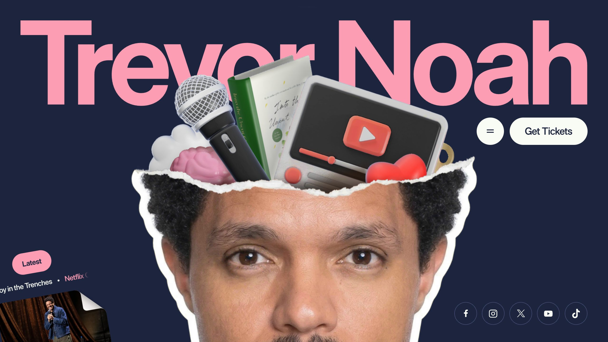
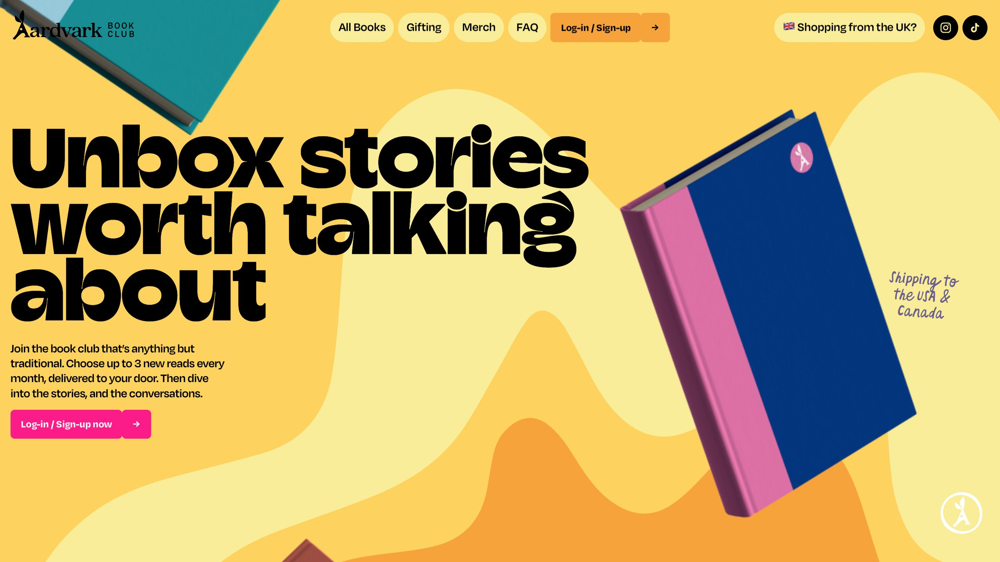
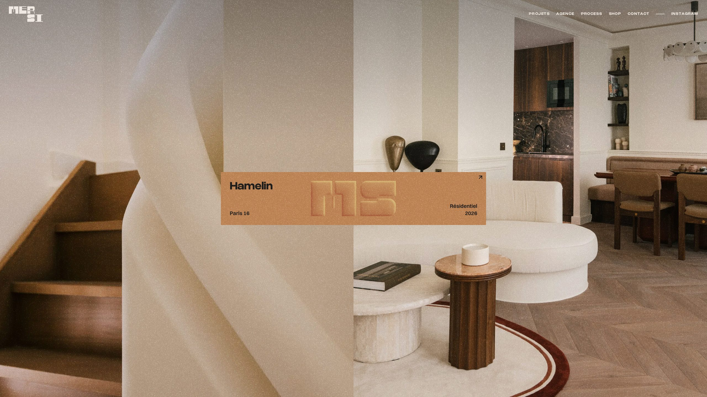
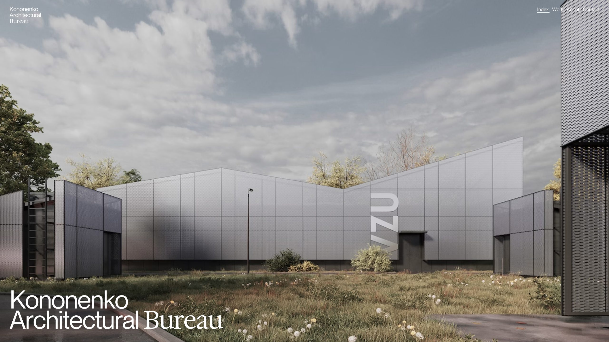
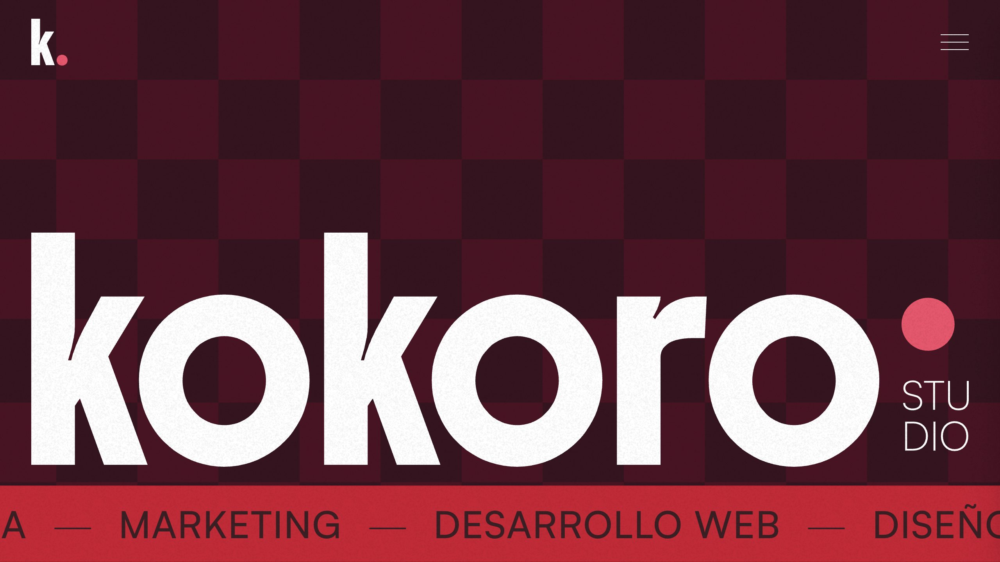

# FIELD: направление дизайна v4

Исследование от 8 октября 2026 года. Период поиска: 8 мая — 8 октября 2026. Это рекомендации перед новой версткой. Опубликованный лендинг v3 не изменён.

## Главный вывод

Предлагаю строить сайт вокруг **зимнего интенсива НИИ Нейросетей**: большой, уверенный заголовок; глубокий синий фон с оттенком морской волны; выразительная пространственная композиция; затем светлые, удобные для чтения разделы. Общий образ — профессиональная среда, в которой люди учатся, пробуют и находят направление для своей работы.

Наша узнаваемая графическая идея — **три маршрута зимнего сезона, которые встречаются в FIELD**. Кэмп, практика и стратегия получают постоянные цвета и предметные образы. Графика связывает первый экран, программу и стоимость. За счёт этой связи движение объясняет, что человек покупает.

## Как проводилось исследование

Проверены датированные авторские разборы Codrops за май–сентябрь, подборки Webzibition, CSS Design Awards и Orpetron. Пять выбранных сайтов открыты в браузере; их первые экраны сохранены. Дополнительно прочитаны разборы Obys, Horeca и Bisous. Текущие hero и стоимость FIELD проверены в браузере и по исходным файлам.

У референсов указана дата публикации разбора, редакционной подборки или награды. Это не обязательно дата запуска сайта. Под «заметными» здесь понимаются проекты, отобранные профессиональными редакциями или отмеченные премиями. Данных, позволяющих назвать их самыми обсуждаемыми по всему интернету или доказать высокую конверсию, нет.

## Пять визуальных ориентиров

### Trevor Noah — масштаб и предметная композиция

Включён в июльскую подборку [Codrops Webzibition](https://tympanus.net/codrops/webzibition/page/2/). [Открыть сайт](https://www.trevornoah.com/).

**Наблюдение:** огромная типографика, тёмно-синий фон, фото и объёмные предметы; кнопка билетов хорошо отделена от сцены. **Для FIELD:** название интенсива занимает большую часть первого экрана, а графика выходит за границы условной колонки. Читаемость всех слов сохраняем: перекрывать название предметами, как в референсе, нам не нужно.

### Aardvark Book Club — участие ощущается как продукт

[CSS Design Awards: Website of the Day, 3 августа 2026](https://www.cssdesignawards.com/sites/aardvark-book-club/49745/). [Открыть сайт](https://www.aardvarkbookclub.com/).

**Наблюдение:** жёлтая сцена, крупные книги, выразительные буквы; дальше — иллюстрированная последовательность участия. **Для FIELD:** показывать состав сезона как осязаемый набор возможностей. У кэмпа, практики и стратегии должны быть свои узнаваемые образы. При этом стоимость у нас должна быть видна напрямую: размещение цены внутри FAQ у референса не берём.

### MERSI — композиция и ощущение материала

[Авторский разбор FLOT NOIR, 27 июля 2026](https://tympanus.net/codrops/2026/07/27/between-print-and-digital-the-making-of-mersis-website/). [Открыть сайт](https://www.mersi-architecture.com/).

**Наблюдение:** фотография занимает почти весь экран, центральная плашка выглядит отдельным предметом. В разборе авторы объясняют переходы, связанные с раскрытием проекта. **Для FIELD:** дать изображениям больше пространства, собирать блоки с разным ритмом. Спокойная архитектурная эстетика целиком нам не подходит: нужны более энергичные цвета и ясный коммерческий первый экран.

### Kononenko — движение раскрывает работу и людей

[Авторский разбор, 18 сентября 2026](https://tympanus.net/codrops/2026/09/18/kononenko-architectural-bureau/). [Открыть сайт](https://kononenkogroup.com/).

**Наблюдение:** на первом экране доминирует изображение, текст встроен в общую композицию. По авторскому разбору: движение связывает рабочие материалы, проекты и команду; выразительные эпизоды чередуются со спокойными. **Для FIELD:** анимировать переход от исходной задачи к результату и раскрытие состава программы. Сложную навигацию архитектурного портфолио переносить не стоит.

### Kokoro — глубокий цвет и характер

[Orpetron: Site of the Day, 29 сентября 2026](https://orpetron.com/sites/kokoro-studio/). [Открыть сайт](https://www.itskokoro.studio/).

**Наблюдение:** тёмная основа имеет насыщенный оттенок; крупная белая типографика и красная полоса формируют сильный контраст. **Для FIELD:** использовать глубину цвета и крупные цветовые плоскости. Бордовый и клетку не копируем — у НИИ есть собственные синий, бирюзовый и коралловый.

## Что подтвердилось на более длинном периоде

[Obys, 14 мая 2026](https://tympanus.net/codrops/2026/05/14/designing-ourselves-the-new-obys-identity-and-website/) описывает систему, где фирменная форма и движение связывают разные композиции, включая переход от тёмного к светлому. Для нас полезен принцип единого графического мотива на всей странице; сам логотип НИИ деформировать не нужно.

[Horeca, 10 июня 2026](https://tympanus.net/codrops/2026/06/10/building-horeca-advanced-motion-design-in-webflow-without-the-performance-trade-offs/) — полезный технический разбор заметной анимации и её ограничений. Авторы отдельно описывают проблемы искусственного плавного скролла на мобильном. Это опыт одного проекта, а не универсальный запрет библиотеки. Для FIELD предлагаю сохранить обычную прокрутку и упростить мобильную постановку сцен.

[Bisous, 29 июня 2026](https://tympanus.net/codrops/2026/06/29/inside-bisous-designing-an-editorial-experience-for-cinematic-cgi/) показывает сочетание устойчивой сетки, больших изображений и выразительных переходов. Для нашей страницы полезна именно сетка, удерживающая разнообразные блоки в одной системе. Длинную заставку и бесконечную галерею для продажи интенсива брать не предлагаю.

## Тенденции, которые полезны FIELD

Это выводы по выбранным проектам, а не количественное исследование всего рынка.

- **Типографика формирует композицию.** Название сезона должно определять первый экран. Мелкая надпись над общим обещанием не справляется с этой задачей.
- **Предметная графика делает предложение понятнее.** Материалы, документы, маршрут и живые люди ближе к нашему продукту, чем отвлечённая технологическая сфера.
- **Есть сквозной визуальный мотив.** В нашем случае — три направления, их цвета и траектории. Они повторяются с разной интенсивностью.
- **Сильное движение чередуется с паузами.** Человек получает впечатление, затем спокойно читает программу, отзывы и условия.
- **Глубокие цветные фоны заменяют плоскую черноту.** Тёмный hero может быть насыщенным и тёплым по ощущению, а основная страница — светлой.
- **Материальность создаётся светом и пространством.** Умеренная глубина, направленная тень, фактура изображения и точная композиция убедительнее обилия рамок и эффектов.

## Что в v3 мешает задаче

Первый экран показывает общее обещание об ИИ крупнее названия продукта. Посетителю приходится собирать из нескольких мест, что это за программа, когда она проходит и как к ней относится FIELD.

Схема «текст слева — иллюстрация справа» остаётся привычной. Бумажная графика помогает объяснять задачи, но в роли главного образа даёт более лёгкое, учебное впечатление, чем нужно для программы руководителей и предпринимателей.

Жёсткие смещённые тени кнопок и карточек делают интерфейс похожим на плакатный конструктор. Рекомендую уменьшить их роль, оставить выразительную типографику и добавить глубину в саму сцену.

На цене уже есть жёлтый фон, но внутри — длинный перечень условий и несколько конкурирующих переходов. Добавление ещё одного яркого цвета проблему не решит. Нужно собрать понятный объект покупки и выделить одно основное действие.

Анимация по краям страницы почти не участвует в рассказе. Её можно заметить, но она мало объясняет. Следующая версия должна показывать, как устроено участие и что делает человек.

## Новый первый экран

### Содержание и иерархия

1. Логотип НИИ и подпись FIELD: организатор и среда участия.
2. Главный заголовок: **«Зимний интенсив НИИ Нейросетей»**. Слова «Зимний интенсив» — самые крупные; название НИИ остаётся частью легко читаемого заголовка.
3. Хорошо заметная строка: **«Ноябрь 2026 — январь 2027»**.
4. Подзаголовок: **«Три месяца учёбы, практики и стратегии в сообществе FIELD»**.
5. Пояснение: «Осваивайте ИИ на задачах своей работы. Пробуйте новые подходы, разбирайте результаты с экспертами и понимайте, куда двигаться вам и вашей компании».
6. Короткие факты: старт 9 ноября · онлайн · можно с нуля.
7. Основная кнопка: **«Присоединиться к интенсиву»**. Второй переход: **«Посмотреть программу»**.
8. Цена рядом с действием: **«350 евро или 35 тысяч рублей за все 3 месяца»**.

На странице должна быть единая иерархия названий: зимний интенсив — предложение; НИИ Нейросетей — организатор; FIELD — сообщество; НН-6 — основной кэмп внутри программы. Знакомить новичка одновременно с четырьмя равнозначными брендами не стоит.

### Изображение и глубина

За заголовком и сбоку — пространственная композиция из трёх маршрутов. В ней крупные предметные элементы: тетрадь или набор учебных материалов для кэмпа, собранный рабочий документ для практики, карта решений для стратегии. Они сходятся в общее поле. Подписи добавляются обычным текстом в верстке, чтобы оставаться чёткими на любом экране.

Изображение нужно создать под эту композицию, с собственными материалами, светом и перспективой. Не имитировать несуществующее приложение. Маскоту можно оставить небольшую роль в блоке поддержки; в hero предпочтительнее взрослый предметный образ.

Заголовок и кнопки неподвижны. На курсор мягко реагируют фон и предметы. Предлагаемый стартовый диапазон смещения на десктопе — 12–28 px; это проектное решение, которое ещё нужно оценить в прототипе. На мобильном композиция короче и проще, после основного содержания.

## Цветовой сценарий

| Зона | Предлагаемая палитра | Назначение |
| --- | --- | --- |
| Hero | #0B1220 с глубиной до #112B35; текст #F6F3EB | Уверенный вход, глубина, высокий контраст |
| Главная кнопка | #E8734A, тёмный текст | Один узнаваемый акцент действия |
| Основное чтение | #F6F3EB и белый | Комфортная программа, кейсы и отзывы |
| Кэмп НН-6 | #7DD4C8 | Последовательное обучение |
| Практика | #E8734A и его светлые оттенки | Применение к рабочим задачам |
| Стратегия | #3B82F6 и светлая синяя подложка | Путь компании и карьеры |
| Стоимость | #F5C842 + светлая поверхность абонемента | Ясный финальный акцент |

Это предложение для веб-страницы на основе фирменной палитры, не изменение канона бренда. На тёмном первом экране нужен исходный светлый логотип НИИ; при переходе шапки на светлый фон — тёмный. Нельзя снова оставлять чёрные буквы логотипа на тёмном фоне или перекрашивать знак фильтром.

Цвет направления повторяется в программе, календаре и составе абонемента. К нему всегда добавляется текстовая подпись: человек не должен расшифровывать всё по цвету.

## Цена: абонемент на зимний сезон

Вместо длинной вертикальной карточки — один широкий абонемент с ясными зонами. Слева название сезона, даты и три цветные части: «Кэмп НН-6», «Практика», «Стратегия». Справа — стоимость, срок и основная кнопка. На мобильном эти зоны идут друг за другом.

**350 евро**

или

**35 тысяч рублей**

**За все три месяца участия.**

Обе суммы набраны одним шрифтом, начертанием и размером. «Или» можно сделать спокойнее. Цена не выглядит ежемесячной, не привязана отдельно к кэмпу и не разбивается на искусственные платежи.

Под тремя направлениями — короткая строка о записях, материалах и поддержке. Условия для выпускников — компактный отдельный вход ниже основного предложения. Вопросы команды и VIP не конкурируют с главной кнопкой внутри абонемента. Их место рядом, в зоне консультации.

Для живости достаточно раскрытия абонемента при появлении и последовательной сборки трёх цветных частей. Постоянно вращать цену, пересчитывать цифры, использовать фиктивную скидку или таймер не нужно.

В текущей опубликованной версии платёжная форма демонстрационная. До подключения подтверждённой оплаты финальное действие должно честно вести к обсуждению участия с Юрием; надпись и результат нажатия должны совпадать.

## Сценарий движения по странице

| Участок | Что происходит | Для чего | Мобильная версия |
| --- | --- | --- | --- |
| Hero | Большая многослойная композиция, медленное движение глубины и параллакс | Первое впечатление и три направления сезона | Постер или один лёгкий движущийся слой |
| Переход к задачам | Линии маршрутов ведут к следующему разделу | Связь между обещанием и применением | Простое появление |
| Без ИИ / с ИИ | Из разрозненных материалов собирается проверяемый документ | Показать смысл работы с ИИ | Переключатель с коротким переходом |
| Состав участия | Три крупных элемента собираются в одну программу | Объяснить состав покупки | Три обычных последовательных блока |
| Календарь | Плавная смена месяца, цветные метки направлений | Быстро найти нужные встречи | Те же вкладки, без перехвата свайпа |
| Команда | Небольшое последовательное появление портретов | Сделать людей заметнее | Статичные фотографии и раскрытия |
| Отзывы | Спокойная сетка и раскрытие истории | Дать прочитать доказательства | Без автопрокрутки |
| Абонемент | Короткая сборка состава и появление итоговой цены | Завершить рассказ предложением | Неподвижная цена и крупная кнопка |

Три наиболее выразительных эпизода — hero, «до/после» и состав участия. В остальных разделах движение поддерживает навигацию. Предлагаемые длительности для первого прототипа: отклик кнопки 150–220 ms, раскрытие 250–400 ms, сборка сцены 600–900 ms. Это стартовые настройки, а не доказанный рецепт конверсии.

## Кнопки и чтение

- Основное действие имеет один цвет и стабильную формулировку. У вторичного перехода спокойный фон или текстовый стиль.
- При наведении меняются свет, рамка или небольшой внутренний элемент. Сама кнопка остаётся на месте: за ней не приходится гоняться курсором.
- Плюс раскрывает материал; стрелка означает переход. Декоративная стрелка не маскируется под работающую кнопку.
- Вся строка раскрывающегося элемента нажимается; состояния видны с клавиатуры.
- Для мобильных кнопок предлагаю высоту 48–56 px. Это наш запас удобства, а не буквальный минимум WCAG. В WCAG 2.2 для минимального размера цели указано 24 × 24 CSS px с исключениями: [W3C](https://www.w3.org/WAI/WCAG22/Understanding/target-size-minimum.html).
- Крупный вопрос остаётся заголовком раздела. Ответ идёт следующим уровнем. Длинные пояснения не забирают у вопроса визуальный приоритет.

## Быстродействие и мобильный опыт

Для выразительной версии не требуется переводить весь сайт в 3D. Предлагаю один WebGL-слой для фоновой сцены, а текст, кнопки и карточки оставить обычной версткой. Основное содержание доступно сразу; загрузка графики его не блокирует. За пределами видимости и в неактивной вкладке движение приостанавливается.

Простые перемещения и прозрачность стоит делать через transform и opacity, избегая постоянного пересчёта размеров блоков. Это соответствует рекомендациям [web.dev по производительности анимации](https://web.dev/articles/animations-and-performance).

Сохраняем обычную прокрутку. Мобильный вариант проектируется отдельно: без реакции на курсор, длинных закреплённых сцен и обязательного видео. Для слабого устройства или отсутствия WebGL остаётся качественный статичный фон.

При системной настройке reduced motion убираем декоративный параллакс и движение. Видимый переключатель позволяет остановить фон; для автоматически движущегося содержимого применяются условия [W3C Pause, Stop, Hide](https://www.w3.org/WAI/WCAG21/Understanding/pause-stop-hide.html). Отключаемая анимация взаимодействий также соответствует направлению [W3C Animation from Interactions](https://www.w3.org/WAI/WCAG22/Understanding/animation-from-interactions.html).

Цели проверки после реализации: LCP ≤ 2,5 s, INP ≤ 200 ms, CLS ≤ 0,1 на 75-м процентиле отдельно для мобильных и десктопа — [Google Web Vitals](https://web.dev/articles/vitals). Это будущие критерии, а не результаты измерения нынешнего сайта. Лабораторная проверка до запуска нужна отдельно и не заменяет реальные данные посещений.

## Что ещё усилит продажи

**Быстрое понимание продукта.** За первые секунды человек должен назвать формат, сроки, аудиторию и следующий шаг. Общая польза ИИ уже вторична по отношению к этому объяснению.

**Понятная нагрузка.** 33 доступных мероприятия — ценность, но для занятого новичка это может выглядеть как обязательный объём. Рядом нужен простой маршрут: основной кэмп и дополнительные темы по выбору. Не обещать конкретное количество часов в неделю, пока оно не подтверждено.

**Живое доказательство.** В начале страницы полезнее один ясный пример результата с контекстом, а ближе к решению — несколько разных историй. Видеозаписи загружаются по нажатию. Отзывы можно фильтровать по типу задачи, если для каждого есть достаточные данные.

**Доверие к людям.** В карточке преподавателя важен ответ «с чем именно он поможет мне этой зимой». Портрет, имя и роль должны читаться сразу. Состав команды и партнёрские логотипы из v3 сохраняются как подтверждённая основа; исследование дизайна не добавляет новые фактические заявления о клиентах.

**Короткий путь к участию.** После интереса к программе человек видит одну общую стоимость и понятное действие. После оплаты — реальное приглашение, доступ и начало работы. Красивый экран сам по себе этот путь не завершает.

**Проверка гипотезы.** Сначала показать первый экран 5–7 людям из целевой аудитории и попросить своими словами объяснить, что предлагается и на какой срок. Затем, при достаточном трафике, сравнивать переходы к программе, цене и фактические обращения/оплаты. Награда за дизайн и длительность просмотра не доказывают продажи.

## Какие навыки пригодятся

- **nii-brand-guidelines:** использован для сверки палитры, шрифтов и правил логотипа.
- **product-design audit / ideate:** изучены как инструменты проверки и выбора визуального направления. В следующем этапе полезны для сравнения первого экрана и цены на десктопе и мобильном; полный процесс этих навыков в данном исследовании не запускался.
- **figma-shaders:** изучен; нужен для работы с шейдерами именно в Figma, поэтому сейчас его подключение к реализации не требуется.
- **imagegen:** подходящий инструмент следующего этапа для авторской предметной композиции и серии совместимых иллюстраций. В этом исследовании новые изображения не генерировались.

Новые плагины и библиотеки не установлены. Для большей части предложенных изменений достаточно нынешнего проекта; необходимость дополнительной библиотеки анимации стоит определять после согласования конкретной сцены.

## Порядок следующей переработки

1. Пересобрать hero: название, сроки, смысл FIELD, изображение и глубокий фон.
2. Оформить общий абонемент и привести все основные кнопки к единой логике.
3. Создать одну серию графики для трёх направлений и примеров «до/после».
4. Поставить три крупные сцены движения и связать их спокойными переходами.
5. Проверить мобильную версию, выключенную анимацию, скорость и путь к участию.

На этом этапе созданы только исследовательский отчёт и подборка скриншотов. Ни файлы лендинга, ни публикация на Vercel не менялись. Следующий результат — новая визуальная версия, основанная на этом направлении.
