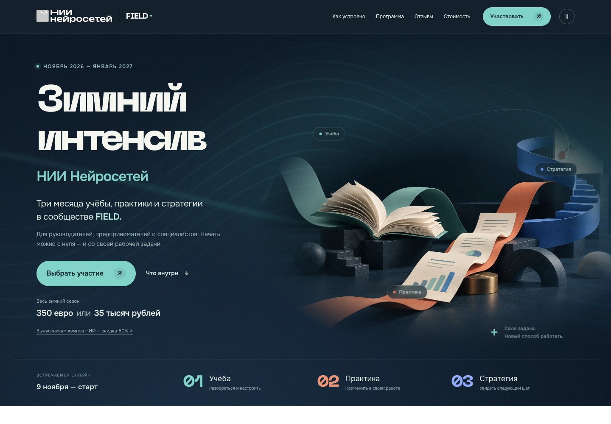
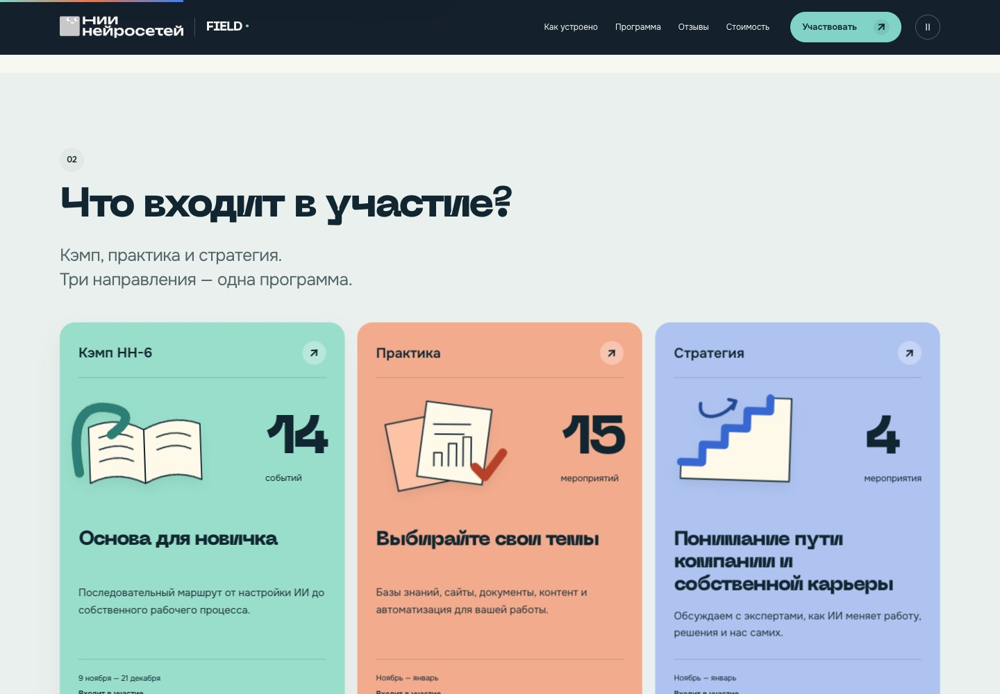
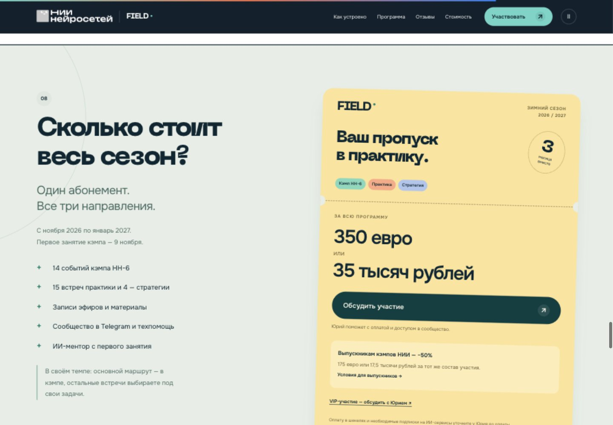

# FIELD — лендинг v4

Готово 8 октября 2026. Новая версия развёрнута как Vercel Preview: **READY**.

- [Открыть v4](https://nii-field-winter-v3-n2vadqif1-dmitriis-projects-8673976b.vercel.app) — действует обычная авторизация Vercel.
- [Локальный просмотр](http://127.0.0.1:8846/index.html#top).
- [Архив сайта](FIELD-лендинг-v4.zip).

## Что изменено

Первый экран теперь прямо называет продукт: **Зимний интенсив НИИ Нейросетей. Ноябрь 2026 — январь 2027. Три месяца учёбы, практики и стратегии в FIELD.** Глубокий сине-зелёный фон, белая версия фирменного логотипа, крупный заголовок, ясная аудитория и переход к участию.

Для hero встроенным генератором imagegen создана новая предметная иллюстрация: книга, рабочие документы и архитектурный маршрут. Цвета повторяются дальше на странице: мятный — кэмп, коралловый — практика, синий — стратегия. В карточках направлений появились самостоятельные векторные иллюстрации.

Движение: WebGL-контуры фона, параллакс иллюстрации, появление карточек, движение предметных иконок, сборка результата в примерах «до / после». На телефоне амплитуда и разрешение ниже. Есть пауза и поддержка prefers-reduced-motion; цикл первого экрана останавливается вне видимой области и при скрытой вкладке. При недоступности WebGL остаются изображение и весь контент.

Стоимость оформлена как сезонный абонемент: **350 евро или 35 тысяч рублей за всю программу**. Для выпускников — отдельный вариант 175 евро или 17,5 тысячи рублей. Одинаковый шрифт для валют, состав программы рядом с ценой.

Вместо неподключённой формы оплаты — честный путь через Юрия. Кнопка «Обсудить участие» открывает условия и переход в Telegram; при отключённом JavaScript работает прямая ссылка на Юрия. Сообщения не отправляются автоматически. Платёжные настройки не изменялись.

## Что сохранено и проверено

- 14 событий кэмпа, 15 встреч практики и 4 стратегии; отдельно 19 мероприятий в календаре.
- 9 участников команды, 29 материалов на отдельной странице отзывов: 12 историй, 3 текстовых отзыва и 14 видео.
- Фирменные логотипы, подтверждённые компании, исключения из предыдущего брифа.
- Зимнее время: 19:00 Москва / 18:00 Израиль / 17:00 CET.
- Локальные страницы: index.html, alumni.html, reviews.html. Нет отсутствующих файлов, дублирующихся id и сломанных внутренних якорей.
- В браузере: 1440, 390 и 320 px; горизонтального переполнения не обнаружено. Проверены меню, месяцы, фильтр стратегии, раскрытие события, клавиатура в программе, примеры задач, окно участия, пауза, reduced motion, тариф выпускника и фильтр видеоотзывов.
- В проверенной основной странице ошибок и предупреждений JavaScript не зарегистрировано.

Иллюстрация: 97 722 байта для десктопа и 30 180 для телефона. Основные файлы первого экрана суммарно около 499 КБ до сжатия, включая шрифты. Это размеры файлов, **не измерение скорости на мобильной сети или Core Web Vitals**. Safari, реальные устройства, платежи и рост конверсии не проверялись.

## Публикация

Vercel project: nii-field-winter-v3. Deployment: dpl_DiRbGThUFgwY4CTZDqc13V6VQoTm. Target: preview. READY подтверждён Vercel CLI. Предпросмотр требует входа в Vercel, поэтому публичный визуальный просмотр онлайн пока не подтверждён. Снимки ниже — проверенная локальная версия тех же файлов.

Первая попытка загрузки унаследовала посторонний коммит общей базы Obsidian и была заблокирована. Повторная загрузка тех же публичных файлов из отдельной папки вне Git успешно завершена. Настройки доступа проекта не изменялись. Создание временной ссылки без авторизации сначала отклонено автоматической проверкой разрешений. Пользователь после уточнения выбрал «Оставить вход через Vercel». Ссылка без авторизации не создавалась.

В загрузку входят только 38 файлов сайта и vercel.json. Внутренние исследования, переписки и рабочие документы исключены. Текущий публичный адрес nii-field-winter-v3.vercel.app пока ведёт на прежнюю v3.

## Изменённые файлы

Основной рабочий каталог:
/Users/bigd/Obsidian Vault/Сообщество/02 Field (продукт 2.0)/00_brief/HANDOFF — лендинг aicamp6 и A-B варианты — 2026-10-08/outputs/готовое

- index.html, alumni.html, reviews.html
- assets/style-v4.css, assets/app-v4.js, assets/motion-v4.js
- assets/hero-v4.webp, assets/hero-v4-small.webp, assets/nii-logo-white.webp
- site-v4-files.txt, проверка/static-v4.json, проверка/qa-v4.json

Сборка и воспроизведение: рабочее/build_v4.py, рабочее/v4-overrides.css, рабочее/verify_v4.py. Снимки исходной v3 сохранены рядом. Промт генерации и оригинал изображения: рабочее/imagegen-v4-prompt.md, рабочее/hero-v4-original.png.

